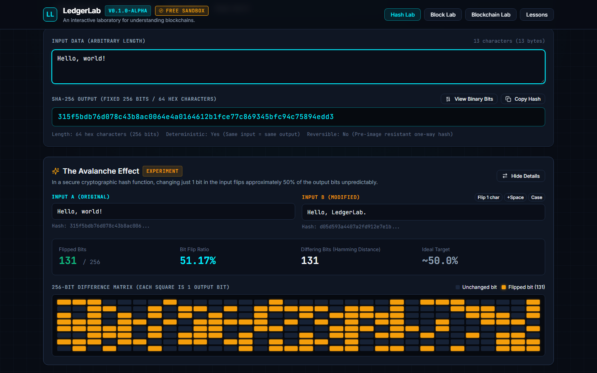
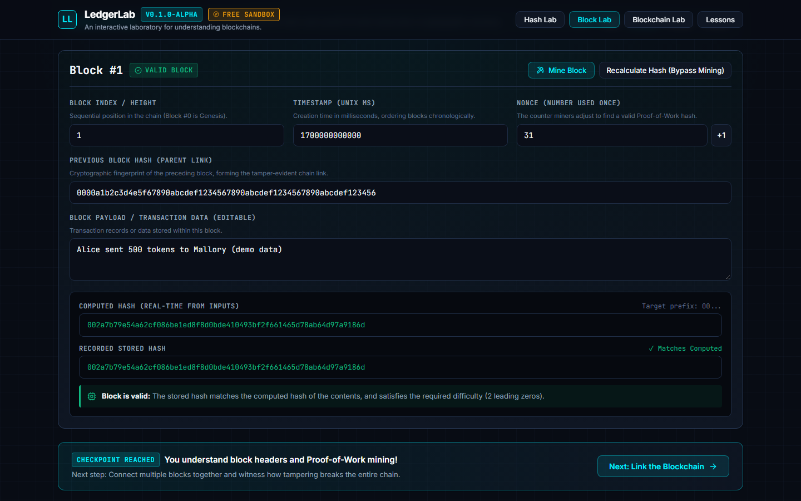
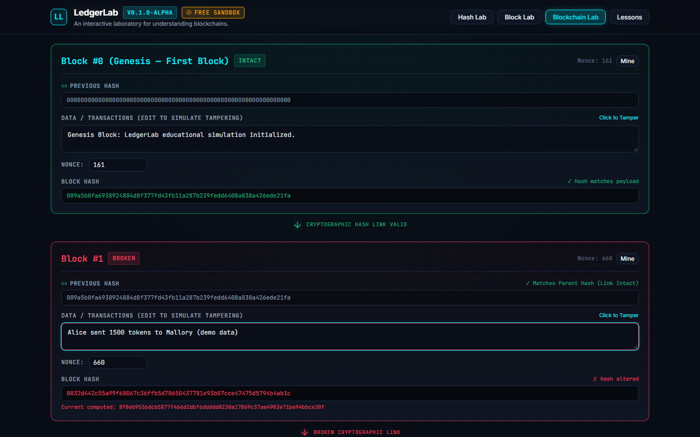

# LedgerLab

An interactive, browser-only laboratory for learning how a blockchain works by changing data and watching what breaks: SHA-256 hashing, block structure, proof-of-work and tamper-evident chains. Everything is simulated client-side; there is no backend, no wallet and no real currency.


<sub>Screenshot of the running app (Hash Lab, free-sandbox mode). Input text is demo data.</sub>

## What you can do in it

| Lab | What it shows | Status |
| :-- | :-- | :-- |
| **Hash Lab** | Live SHA-256 of any text, the 256-bit output, and an avalanche view that compares two inputs bit by bit (Hamming distance). | Implemented, covered by unit and browser tests |
| **Block Lab** | One block with editable index, timestamp, previous hash, data and nonce. Edit the data and the stored hash stops matching; press *Mine Block* to search for a nonce whose hash has the required leading zeros. | Implemented, covered by unit and browser tests |
| **Blockchain Lab** | A 4-block chain at difficulty 2. Edit an old block and it, plus every block after it, turns invalid; re-mine from the first broken block to repair it. | Implemented, covered by unit and browser tests |
| **Lessons** | Two guided lessons (hashing, chain integrity) with steps, hints and a conceptual question about 51% attacks. | Implemented, covered by unit and browser tests |
| **Guided Journey** | A start screen and a "mission" panel per lab that walks a first-time learner through stages 1 to 4. Can be switched off for free exploration. | Implemented, covered by browser tests |
| Wallets and signatures, transactions and mempool, Web Worker mining, multi-node network and attack simulations | | Planned (see [roadmap](docs/roadmap.md)) |

<table>
  <tr>
    <td width="50%"></td>
    <td width="50%"></td>
  </tr>
  <tr>
    <td><sub>Block Lab after editing the data and mining a new nonce (demo data).</sub></td>
    <td><sub>Blockchain Lab after tampering with Block #1 (demo data).</sub></td>
  </tr>
</table>

All images are real captures of the app running locally with Playwright (1440x900 desktop, 390x844 mobile). The transaction strings in them are made-up demo data.

## Run it

Requires Node.js 18 or newer (tested with Node 22).

```bash
git clone https://github.com/JeyaVardhan-L/LedgerLab.git
cd LedgerLab
npm ci
npm run dev          # http://localhost:3000
```

Checks:

```bash
npm test             # Vitest unit tests
npm run lint         # ESLint, zero warnings allowed
npm run format:check # Prettier
npm run build        # tsc type check + Vite production build into dist/
npx playwright install chromium   # once, for the browser tests
npm run test:e2e     # Playwright browser tests (starts the dev server itself)
```

A GitHub Actions workflow (`.github/workflows/ci.yml`) runs all of these on every push to `main` and on pull requests.

## How it works

```text
src/
├── crypto/      sha256.ts (hand-written SHA-256), avalanche.ts (bit-level diff)
├── engine/      block.ts (hash, validate, mine), blockchain.ts (chain, tamper, repair)
├── education/   lesson data and types
├── components/  React UI: HashLab, BlockLab, BlockchainLab, LessonRunner, guidance panels
└── styles/      design tokens and shared CSS
```

- **Engine separate from UI.** `crypto/` and `engine/` are plain TypeScript with no React imports, so all the blockchain rules are unit-tested in Node without a browser.
- **Block hash.** `SHA-256(index | previousHash | timestamp | data | nonce | difficulty)`. A block is valid when its stored hash equals that recomputation and starts with `difficulty` zero hex digits.
- **Chain validation** (`validateChain`) checks, per block: genesis points at 64 zeros, stored hash matches the contents, the hash meets the network difficulty, the declared difficulty equals the network difficulty, and the block links to a valid predecessor. That last rule is what makes one edit invalidate every later block.
- **Why a hand-written SHA-256?** The browser's Web Crypto API is asynchronous. The labs recompute hashes on every keystroke and during mining, and a synchronous function keeps that code simple. The implementation is checked against published test vectors and against Node's `crypto` module at the 55/56/64-byte padding boundaries and on multi-byte UTF-8 input (`tests/unit/sha256-crosscheck.test.ts`).
- **Mining without freezing the page.** The Block Lab mines in steps of 5,000 nonces per timer tick (`mineBlockStep`) and can be cancelled. The Blockchain Lab mines synchronously, which is quick at its fixed difficulty of 2.

More detail: [architecture](docs/architecture.md), [simulation model](docs/simulation-model.md), [education model](docs/education-model.md), [glossary](docs/glossary.md).

## Verified results

Run on 2026-11-10, Windows 11, Node 22.23.2, Chromium (Playwright 1.63):

| Check | Result |
| :-- | :-- |
| `npm test` | 42 of 42 unit tests passed (6 files) |
| `npm run test:e2e` | 3 of 3 browser tests passed |
| `npm run lint`, `npm run format:check`, `npm run build` | all passed |

No performance figures are claimed; hash rate and mining time have not been measured.

## Limits and unfinished work

- Educational only. The chain is a single in-memory list in one browser tab: no network, no peers, no fork choice, no persistence. Repairing a tampered chain is easy here because the learner has all the hash power; the lessons explain why that is not true on a real network, but the app does not simulate it.
- Difficulty is counted in leading zero *hex digits*, not a numeric target, and the Block Lab gives up after 1,000,000 attempts.
- The Blockchain Lab's re-mine runs on the main thread. Higher difficulties would need the planned Web Worker.
- Keys, signatures, transactions, Merkle trees and network attacks are planned, not built.
- Mobile layouts work but were designed desktop-first.

## Origin

LedgerLab replaces **Campus Coin**, an earlier Java/Swing blockchain prototype that this repository started as. That code is kept unmodified for reference in [`legacy/campus-coin-java/`](legacy/campus-coin-java/) and is not built or maintained; see [docs/legacy-campus-coin.md](docs/legacy-campus-coin.md).

## Credits and licence

Built by Jeya Vardhan ([@JeyaVardhan-L](https://github.com/JeyaVardhan-L)). Uses React, Vite, TypeScript and [Lucide](https://lucide.dev) icons (ISC licence). Fonts Inter and JetBrains Mono (SIL Open Font License) are loaded from Google Fonts.

Released under the [MIT License](LICENSE).
